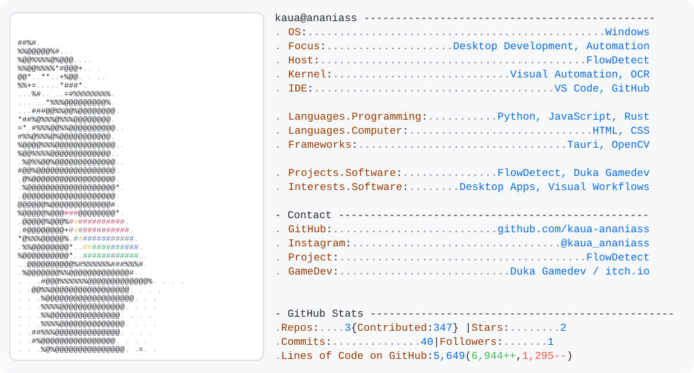

<picture>
  <source media="(prefers-color-scheme: dark)" srcset="./dark_mode.svg">
  
</picture>

<b>Mais sobre mim / Projetos e tecnologias</b>

### Sobre mim

Desenvolvedor focado em aplicações desktop, automação visual e interfaces interativas. Crio ferramentas independentes que combinam frontend, backend local, reconhecimento de imagem e integração com o sistema operacional.

### Tecnologias e ferramentas

- **Python:** automação desktop, processamento de dados, OCR e integração com bibliotecas nativas.
- **JavaScript, HTML e CSS:** interfaces visuais interativas.
- **Tauri:** aplicações desktop leves e multiplataforma.
- **Rust:** comandos nativos, recursos do Windows e integração com o sistema.
- **OpenCV e OCR:** reconhecimento visual e leitura de textos na tela.
- **Excel / Planilhas:** automações baseadas em dados e loops.
- **Git e GitHub:** versionamento e distribuição.
- **Windows Automation:** teclado, mouse, janelas, atalhos e captura de tela.

### O que eu desenvolvo

- Aplicações desktop com interface moderna.
- Ferramentas de automação visual e sistemas baseados em blocos e fluxos.
- Reconhecimento de imagem aplicado à automação.
- Execução remota de automações entre computadores.
- Integrações com planilhas e processos repetitivos.
- Ferramentas independentes voltadas à produtividade.

### Projeto em destaque: FlowDetect

O **FlowDetect** é uma plataforma visual de criação e execução de automações desktop. Usa **HTML/CSS/JavaScript** na interface, **Tauri** no aplicativo, **Python** no backend, **Rust** na integração nativa, **OpenCV** no reconhecimento de imagem e **OCR** na leitura de textos. Inclui blocos, páginas, loops, planilhas e controle remoto entre **Studio e Agent**.

### Outros projetos e redes

Também publico jogos e experimentos no itch.io como **Duka Gamedev**.

- [GitHub](https://github.com/kaua-ananiass)
- [Instagram](https://www.instagram.com/kaua_ananiass/)

